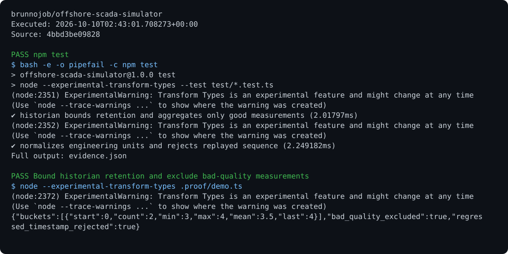

# Offshore SCADA

A local server with WebSocket, Modbus TCP, signal normalization, acknowledged alarms, and history aggregated by time interval.

## Run

Requirements: Node.js 24 and TypeScript.

```sh
npm ci
npm test
npm run dev
```

## Behavior

WebSocket: `ws://127.0.0.1:8080/telemetry`. Modbus TCP: `127.0.0.1:1502`. `/history?tag=name&from=timestamp&to=timestamp&interval=1000` returns the mean, extremes, and latest valid sample. History is held in memory with limited retention; export relevant results for persistence.

## Optional report archive

Use the [shared operations archive client](https://github.com/brunnojob/vercel-home-telemetry-api/tree/main/cloud) to queue `result.json` under project `offshore-scada-simulator`. The client uses `BRUNNODEV_ACCESS_TOKEN` and retains unacknowledged reports locally.

## License

Original source and documentation are MIT licensed; see [LICENSE](LICENSE). Third-party dependencies and media retain their respective terms. Maintained by [Brunno Dev](https://brunnodev.store).

## Implementation update

Motor timing must use nonnegative integer delays. Commands, scans and input updates reject invalid or regressing clocks before changing controller state. Run `npm test`.

Contribution trailer: `Co-authored-by: nyctophile <329826984+ineedfoundmyway@users.noreply.github.com>`.

## Execution proof

[](https://github.com/brunnojob/offshore-scada-simulator/actions/workflows/proof.yml)



[Verified run](https://github.com/brunnojob/offshore-scada-simulator/actions/runs/38017967641) · [Execution report](docs/proof/evidence.json)

Run `python .proof/record.py` after installing the prerequisites above. The scenarios execute repository code and verify exit codes and expected output. CI publishes `execution-proof` with the transcript, input fingerprints and source commit. The downloadable report identifies the exact tested version; the workflow badge tracks the latest run.
